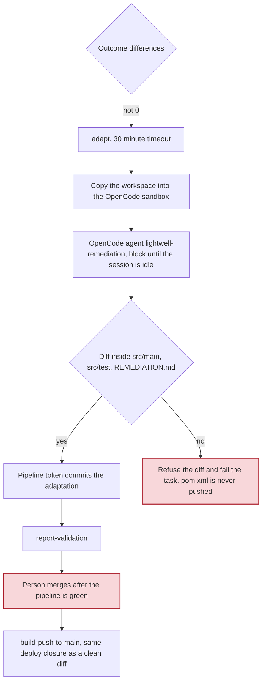
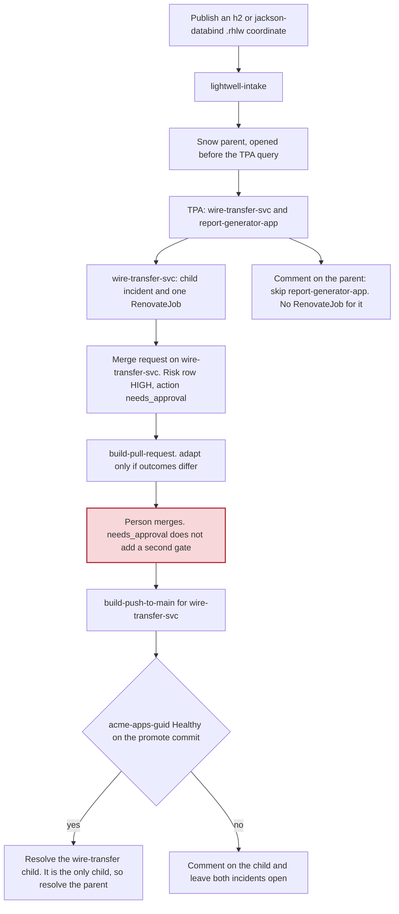
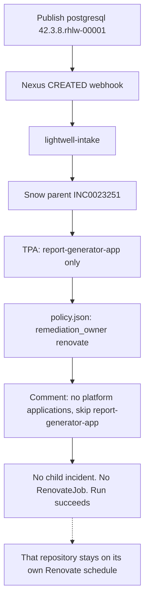

# Demo flow

The control plane has four outcomes. A person merges every platform request. `auto_approve` and `needs_approval` are written on the merge request and do not merge it.

## 1. One platform application, tests match

`commons-text` `1.9.rhlw-00001` affects only `benefits-mgmt-app` (`remediation_owner: ao`, `approval: auto_approve`, risk `LOW`). This is the path that ran to resolution on tenant `6wprg`.

```mermaid
flowchart TD
  publish["Publish commons-text 1.9.rhlw-00001"]
  nexus["Nexus CREATED webhook"]
  intake["lightwell-intake"]
  parent["Snow parent INC, opened before the TPA query"]
  tpa["TPA: benefits-mgmt-app only"]
  policy["policy.json: owner ao, approval auto_approve, risk LOW"]
  child["Child incident for benefits-mgmt-app"]
  job["RenovateJob lw-benefits-mgmt-app"]
  mr["Merge request, pom.xml version only"]
  pr["build-pull-request"]
  tests["fetch-source, run-tests, baseline-tests"]
  diff{"Outcome differences"}
  skip["adapt skipped"]
  report["report-validation: measured rows passed"]
  gate["GitLab keeps Merge disabled until the pipeline succeeds"]
  person["Person merges"]
  main["build-push-to-main"]
  build["maven-build, build-image, SBOM to TPA, promote image tag"]
  argo["wait-for-argo: acme-apps-guid Synced and Healthy"]
  resolve["resolve-incident closes the child, then the parent"]

  publish --> nexus --> intake --> parent --> tpa --> policy
  policy --> child --> job --> mr --> pr --> tests --> diff
  diff -->|"0"| skip --> report --> gate --> person --> main --> build --> argo --> resolve

  style person fill:#f8d7da,stroke:#b02a37,stroke-width:2px
```

## 2. The same request when test outcomes differ

This is the other branch of `build-pull-request`. The publish, intake, and deploy stages stay the same as scenario 1.

## 3. A platform application and a Renovate-owned application in one blast radius

Trusted Profile Analyzer currently finds `h2` in `wire-transfer-svc` and `report-generator-app`. `jackson-databind` has the same shape. `wire-transfer-svc` is `owner: ao`, `approval: needs_approval`, risk `HIGH`. `report-generator-app` is `owner: renovate`.

## 4. A Renovate-owned application only

`postgresql` `42.3.8.rhlw-00001` affects only `report-generator-app`. Intake succeeds and stops. The Module 2 Renovate schedule is untouched.

If the rollout in scenario 1 or 3 is not healthy, `resolve-incident` still runs. It comments on the open child and does not resolve it, so the parent stays open too. A later healthy run for that application is what closes them.
