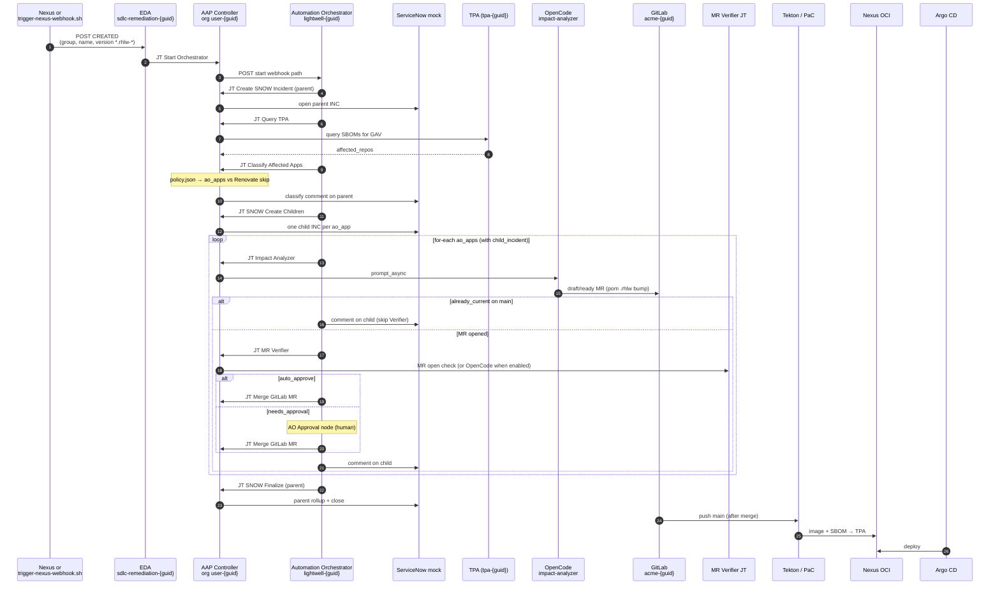

# Demo flow — AO Path 2 component interactions

Operator narrative for **Automation Orchestrator Path 2**: how the Showroom
two-path lab maps onto the platform, who talks to whom, and what the AO canvas
owns. Path 1 (Renovate) appears only where it shares CI/CD.

Last updated: 2026-10-16

**AO docs set:** [architecture.md](architecture.md) (wiring) ·
[DEMO-FLOW-INVESTIGATION.md](DEMO-FLOW-INVESTIGATION.md) (live snapshot) ·
[README.md](README.md) (index) · scripts [../README.md](../README.md)

Also: [HANDOFF.md](../../HANDOFF.md), [ADR.md](../../ADR.md), Showroom under
[`content/modules/ROOT/pages/`](../../content/modules/ROOT/pages/).

---

## Live cluster status

### Current lab — `cluster-5trcs` / guid `cng2l` (admin)

| Item | Status |
|------|--------|
| Domain | `apps.cluster-5trcs.dyn.redhatworkshops.io` |
| Tenant Argo | `lightwell-tenant-cng2l` → fork `sshaaf/lightwell-workshop` @ `main` (manual sync; local `--local` used for chart iteration) |
| Bootstrap Jobs | Complete: GitLab, AAP, AO, EDA, sync-gitlab-pat, nexus-reconcile |
| GitLab | Group `acme-cng2l` + 3 Acme apps; reset via [`reset-demo-repos.sh`](../reset-demo-repos.sh) |
| AO | Project `lightwell-cng2l`; workflow **Lightwell Remediation** (multi-app + SNOW); start path `lightwell-remediation-start-cng2l` |
| EDA | Activation running; rulebook `sdlc-remediation.yml` (AO bridge only — no MR-open → Resume) |
| Nexus | Hosted `lightwell-remediated` / `lightwell-validated` + `oci`; LW Network proxies/webhooks often **missing** (empty creds) |
| Path 2 entry | Use [`trigger-nexus-webhook.sh`](../trigger-nexus-webhook.sh) to POST a Nexus-shaped `CREATED` to the EDA route (bypasses Nexus upload) |
| Path 2 E2E | Proven 2026-10-16: SNOW → TPA → classify → Impact → Verifier → merge → finalize (0 failed JTs after AO v3 snow URL bake) |

Older snapshots (`t8s2n` / `62b79`, infra-only `j88nz`) live in
[`DEMO-FLOW-INVESTIGATION.md`](DEMO-FLOW-INVESTIGATION.md) if needed.

---

## Two paths (shared CI/CD)

The lab is **two paths that share CI/CD and diverge on who creates the MR**:

| Path | Modules | Trigger → MR author | Uses EDA / AO / AI / ServiceNow? |
|------|---------|---------------------|----------------------------------|
| **Path 1 — Quick Win** | Module 2 | Renovate polls Nexus → GitLab MR → you merge | No |
| **Path 2 — Full Automation** | Module 3 | Nexus (or showcase webhook) → EDA → AO → TPA + OpenCode → GitLab MRs | Yes |

**Shared ending for both:** signed image in Nexus OCI → deploy via ArgoCD → SBOM in TPA.

| Stage | Path 1 | Path 2 |
|-------|--------|--------|
| Trigger | Upload `.rhlw` → Renovate poll | `.rhlw` webhook → **EDA → AO** (or `trigger-nexus-webhook.sh`) |
| Who finds apps | Renovate on one repo’s `pom.xml` | **TPA SBOM query** → classify by `.lightwell/policy.json` |
| Who writes the fix | Renovate Bot | **OpenCode** Impact Analyzer |
| Approval | Always you | `auto_approve` (benefits) / **`needs_approval`** (wire-transfer) |
| Build → sign → deploy → SBOM | Shared (Tekton → OCI → ArgoCD → TPA) | Shared |
| ITSM | None | **ServiceNow mock** end-to-end |

**Apps:**

| App | Policy | Path |
|-----|--------|------|
| `report-generator-app` | `remediation_owner=renovate` | Path 1 |
| `benefits-mgmt-app` | `remediation_owner=ao`, `approval=auto_approve` | Path 2 |
| `wire-transfer-svc` | `remediation_owner=ao`, `approval=needs_approval` | Path 2 |

---

## Operator showcase scripts (`ao-trigger-helper/`)

| Script | Purpose |
|--------|---------|
| [`trigger-nexus-webhook.sh`](../trigger-nexus-webhook.sh) | POST Nexus-shaped `CREATED` to EDA for `needs-approval` (h2) and/or `auto-approve` (flyway-core) |
| [`reset-demo-repos.sh`](../reset-demo-repos.sh) | Re-seed `acme-<guid>/*` from GitHub + policies; close MRs; delete `update-artifact-*` branches |

```bash
cd ao-trigger-helper
./reset-demo-repos.sh cng2l
./trigger-nexus-webhook.sh cng2l needs-approval --watch
# or: ./trigger-nexus-webhook.sh cng2l both --watch
```

---

## Component interaction matrix

| Component | Speaks to | Data sent / received |
|-----------|-----------|----------------------|
| **Lightwell Network** (sim: Nexus hosted / showcase POST) | Nexus or EDA | **Sends:** remediated Maven GAV (`.rhlw-*`). Showcase script skips Nexus and POSTs the webhook body to EDA. |
| **Nexus (Maven)** | Renovate; Tekton; EDA (when webhooks exist); OpenCode | **Sends to EDA:** `component CREATED` (GAV, repo). Hosted `lightwell-remediated` used for Path 1 inject. |
| **Nexus (OCI)** | Tekton; ArgoCD; Chains | Images + attestations. |
| **Renovate** | GitLab; Nexus | Path 1 only — MR as `renovate-bot`. |
| **GitLab (`acme-{guid}`)** | Renovate; OpenCode; Student; PaC | MRs + merge → PaC push webhook. Policy file `.lightwell/policy.json` per app. |
| **EDA** | Nexus / showcase; GitLab MR merge; PaC/Argo signals; AAP | Sensor: `*.rhlw-*` → **Start Orchestrator**; MR-**merged** / build / deploy → **AO Lifecycle Webhook** (never MR-open → Start). |
| **AO** | EDA; AAP; SNOW | Webhook-driven (no Approvals, no AO merge): **start** → parent SNOW → TPA → classify → child SNOW → for-each (Impact → Verifier → SNOW awaiting GitLab merge) → parent note; **merged/build/deploy** triggers → short SNOW lifecycle runs. |
| **AAP JTs** | AO; OpenCode; TPA; GitLab; SNOW | Start Orchestrator, AO Lifecycle Webhook, SNOW / TPA / classify / Impact / Verifier, … |
| **OpenCode** | AAP; TPA; GitLab; LiteLLM | Impact opens draft/ready MR; Verifier defaults to lightweight “MR open” check (`verifier_use_opencode: false` until skill fixed). UI via `opencode-ui-gate`. |
| **TPA** | Query TPA; Tekton SBOM upload | `affected_repos` drives classify (no hardcoded app list). |
| **ServiceNow mock** | AO playbooks | Parent INC at start; one child per AO app (`parent_incident`); iteration comments on children; parent rollup/close. Bake `snow_url` / `snow_svc_url` at AO publish. |
| **PaC / Tekton / Chains / Argo** | GitLab; Nexus; TPA; prod NS | Shared post-merge spine. |
| **Student** | GitLab; AO UI; SNOW; RenovateJob | Path 1 merge; Path 2 human gate on wire-transfer. |

---

## Path diagrams

### Path 1 — Quick Win

```
Lightwell → Nexus (Maven) → Renovate → GitLab MR → (you merge)
  → Tekton (build + SBOM + sign) → Nexus OCI → ArgoCD → OpenShift
  → TPA (SBOM verify)
```

### Path 2 — Full Automation (current AO canvas)

EDA is a sensor. AO owns the run. Verifier runs **in-loop** after Impact —
there is no Resume Orchestrator on MR open.



Narrative shorthand:

```
Trigger → EDA → Start Orchestrator → AO
  → parent SNOW create → Query TPA → Classify (+ parent comment)
  → child SNOW create (per ao_app)
  → for-each AO app:
       Impact → (already_current | Verifier → Approval?/Merge → child SNOW iter)
  → parent SNOW finalize
  → (on merge) Tekton → OCI → Argo → TPA
```

---

## Notes / gotchas that affect demos

- **Path 2 entry without Nexus webhooks:** use
  [`trigger-nexus-webhook.sh`](../trigger-nexus-webhook.sh). Production story is
  still Nexus `component CREATED`.
- **Reset between demos:** [`reset-demo-repos.sh`](../reset-demo-repos.sh) so
  Impact does not short-circuit as `already_current` on an already-bumped pom.
- **Classify = TPA only:** do not invent apps; multi-app demos need SBOM
  coverage for each GAV ([ADR-023](../../ADR.md#adr-023--classify-candidates-are-tpa-affected_repos-only)).
  Showcase `auto-approve` uses `flyway-core` (benefits pom); `needs-approval`
  uses `h2` (wire-transfer). TPA may mis-attribute if SBOMs share labels —
  check classify stdout.
- **Trigger GAV must be a declared pom dependency** or Impact fails
  ([ADR-016](../../ADR.md#adr-016--trigger-artifacts-must-be-declared-dependencies-of-a-seeded-app)).
- **SNOW URLs:** AO node vars bake `snow_url` / `snow_svc_url` at publish;
  EDA rulebook should also pass them on Start Orchestrator
  ([HANDOFF](../../HANDOFF.md) next-up). All SNOW playbooks resolve
  `snow_base = snow_svc_url || snow_url`.
- **No dual Verifier:** GitLab MR-open → Resume removed
  ([ADR-025](../../ADR.md#adr-025--drop-legacy-gitlab-mr-resume-verifier)).
- **OpenCode idle:** wait on `GET /session/status`
  ([ADR-024](../../ADR.md#adr-024--opencode-idle-wait-uses-get-sessionstatus)).
- Green AAP JT ≠ agent done — check OpenCode UI / pod transcript.
- Do not fire within ~1 minute of a tenant Argo sync (EDA activation restart).
- Prefer `ARGOCD_OPTS=--core` + kubeconfig for Argo CLI; tenant user cannot
  list `sdlc-<guid>` — use cluster-admin for agent debugging.
