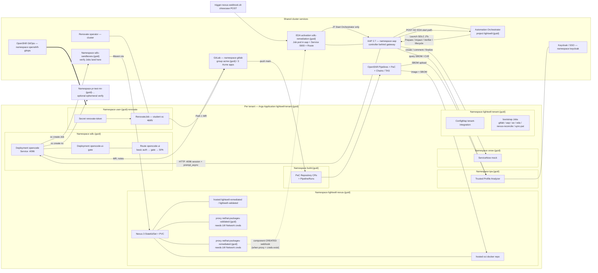
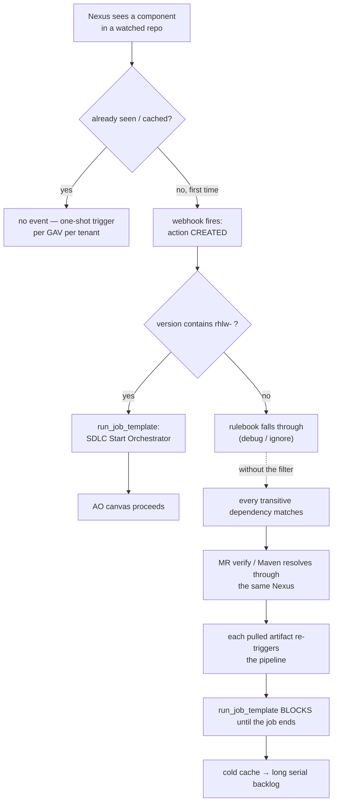

# Lightwell SDLC remediation — per-tenant architecture (AO Path 2)

How one **AO-enabled** tenant is wired, and what happens end to end when a
remediated artifact arrives (Nexus webhook or showcase POST into EDA).

Part of the AO operator docs under [`ao-trigger-helper/docs/`](README.md).
Companion: [DEMO-FLOW.md](DEMO-FLOW.md) (narrative) ·
[DEMO-FLOW-INVESTIGATION.md](DEMO-FLOW-INVESTIGATION.md) (live snapshot) ·
scripts [../README.md](../README.md). Decisions: [ADR.md](../../ADR.md).

Everything below is scoped to **a single tenant**, identified by its `{guid}`
(validation snapshot: `cng2l` on `cluster-5trcs`). Every tenant gets its own copy of
the per-tenant resources; platform services are shared by all tenants on the
cluster.

---

## 1. Component view

One Argo CD `Application` — `lightwell-tenant-{guid}` in `openshift-gitops` —
renders the `bootstrap-tenant` Helm chart and owns everything in the left-hand
box. Everything in the right-hand box was installed once by `bootstrap-infra`
and is shared.



**Automation Orchestrator** is the overall flow controller for Path 2 (shared
platform, per-tenant project). **EDA** is a sensor: Nexus / showcase
`*.rhlw-*` → Start Orchestrator. There is **no** GitLab MR-open → Resume bridge
(ADR-025). OpenCode remains the async worker for Impact (and optionally Verifier).

Note the **activation is per tenant but lives in the shared `aap` namespace**:
EDA runs each activation as a Kubernetes Job pod there, fronted by a Service on
port 5000 and a Route. The activation name carries the guid, so tenants do not
collide, but the namespace is not isolated.

Sandboxes and ephemeral verify namespaces are **per tenant**
(`sdlc-sandboxes-{guid}`, prefix `pr-test-mr-{guid}`).

---

## 2. Two demo paths (shared CI/CD)

| Path | Who opens the MR | Uses EDA / AO / SNOW? |
|------|------------------|------------------------|
| **Path 1 — Quick Win** | Renovate Bot (`report-generator-app`) | No |
| **Path 2 — Full Automation** | OpenCode via AO (`wire-transfer-svc`, `benefits-mgmt-app`) | Yes |

Both share the post-merge spine: PaC / Tekton → Nexus OCI → Chains → Argo CD → TPA SBOM.

Per-app `.lightwell/policy.json`:

| App | `remediation_owner` | `approval` |
|-----|---------------------|------------|
| `report-generator-app` | `renovate` | — |
| `benefits-mgmt-app` | `ao` | `auto_approve` |
| `wire-transfer-svc` | `ao` | `needs_approval` |

---

## 3. Path 2 demo flow (AO canvas)

Authentic story: remediated GAV lands in Nexus → webhook → EDA → AO.
On many lab clusters LW Network creds are empty, so proxy repos and webhooks
never appear — use [`trigger-nexus-webhook.sh`](../trigger-nexus-webhook.sh)
(ADR-031). Reset apps between runs with [`reset-demo-repos.sh`](../reset-demo-repos.sh).

Set `sdlc.orchestrator.enabled=false` only for the legacy rulebook
(`sdlc-remediation-legacy.yml`), where EDA still chains Query TPA → Impact →
Verifier directly (not the Showroom default).

```mermaid
sequenceDiagram
    autonumber
    participant Trigger as Nexus or<br/>trigger-nexus-webhook.sh
    participant EDA as EDA sdlc-remediation-{guid}
    participant Bridge as AAP JT Start Orchestrator
    participant AO as AO lightwell-{guid}
    participant AAP as AAP controller
    participant SNOW as snow-mock snow-{guid}
    participant TPA as TPA tpa-{guid}
    participant OC as opencode sdlc-{guid}
    participant GL as GitLab acme-{guid}
    participant PaC as PaC / Tekton build-{guid}

    Trigger->>EDA: POST CREATED (GAV *.rhlw-*)
    Note over EDA: rulebook filter — action CREATED AND version ~ rhlw-<br/>sensor only; no MR-open Resume

    EDA->>Bridge: run_job_template — SDLC Start Orchestrator
    Bridge->>AO: OAuth + POST /api/v1/webhooks/eda/{startPath}
    Note over AO: single canvas run owns Path 2

    AO->>AAP: JT Create SNOW Incident (parent)
    AAP->>SNOW: open parent INC
    AO->>AAP: JT Query TPA
    AAP->>TPA: query SBOMs for GAV
    TPA-->>AAP: affected_repos + package_info
    AO->>AAP: JT Classify Affected Apps
    Note over AAP: policy.json → ao_apps vs renovate_skips<br/>candidates = TPA list only (ADR-023)
    AAP->>SNOW: classify comment on parent
    AO->>AAP: JT SNOW Create Children
    AAP->>SNOW: one child INC per ao_app (parent_incident)

    loop for-each ao_apps with child_incident
        AO->>AAP: JT Trigger Impact Analyzer
        AAP->>OC: session + prompt_async (impact-analyzer)
        alt already_current on main
            OC-->>AAP: iteration_outcome=already_current
            AAP->>SNOW: comment on child — skip Verifier
        else MR opened
            OC->>GL: bump pom, branch update-artifact-*, MR
            AO->>AAP: JT Trigger MR Verifier
            Note right of AAP: default verifier_use_opencode=false<br/>(GitLab MR-open check)
            alt auto_approve
                AO->>AAP: JT Merge GitLab MR
                AAP->>GL: merge MR
            else needs_approval
                Note over AO: await_gitlab_merge (student merges in GitLab UI)
                GL-->>EDA: MR merged webhook
                EDA->>AAP: JT Signal (await_gitlab_merge)
                AAP->>AO: PATCH /approvals approved
            end
            Note over AO: await_build then await_deploy
            GL->>PaC: push main after merge
            PaC-->>EDA: pipelinerun_terminal (or trigger-cicd-signal.sh)
            EDA->>AAP: JT Signal AO CI/CD Gate (await_build)
            AAP->>AO: PATCH /approvals status=approved|rejected
            PaC->>PaC: promote → Argo → Healthy
            Note over EDA: argo_app_health → Signal await_deploy
            AAP->>SNOW: comment on child (deployed / build_failed / deploy_failed)
        end
    end

    AO->>AAP: JT SNOW Lifecycle + Finalize (parent)
    AAP->>SNOW: brief parent status + child link; Resolve parent
```

Steps worth understanding rather than just watching:

- **EDA is not the orchestrator.** It filters `*.rhlw-*` and runs **Start
  Orchestrator** only. MR Verifier runs **in-loop** on the AO canvas after
  Impact (ADR-025 removed the dual-Verifier Resume path).
- **Classify does not invent apps.** `ao_apps` is derived from TPA
  `affected_repos` + each repo’s `.lightwell/policy.json` (ADR-023).
- **Query TPA blast radius (contract).** For each Acme app name
  (`wire-transfer-svc`, `benefits-mgmt-app`, `report-generator-app`), load the
  newest SBOM (`sort=ingested:desc`) whose `name` matches, then match packages
  whose PURL contains `pkg:maven/{group}/{artifact}` (any version — Nexus
  events carry the *new* `.rhlw-*` version). Emit
  `gitlab_path = {gitlab_group}/{sbom.name}` (default `acme-{guid}/…`).
  Empty list → JT fails (no Impact). **Do not** substitute
  `REMEDIATION_APP_GITLAB_PATH` as the sole affected app. Helper:
  `lw-sdlc-opencode` `playbooks/files/tpa_blast_radius.py`. Live check on
  `cng2l`: h2 → wire (+ report if present); flyway-core → benefits only.
  Renovate-owned hits stay in `affected_repos` and are skipped by classify.
- **Worker AAP jobs are launchers for Impact.** Green JT ≠ agent done; watch
  the OpenCode UI. Verifier currently defaults to a lightweight GitLab “MR open”
  check until the ephemeral OpenCode skill is fixed.
- **SNOW URLs and OpenCode Basic auth are baked at AO publish** into node
  `extra_vars` (`snow_url` / `snow_svc_url`; `opencode_base_url` /
  `opencode_server_username` / `opencode_server_password`). EDA historically
  omitted them from the Start payload — do not rely on bare
  `${trigger.snow_url}` / `${trigger.opencode_server_password}` alone
  (empty OpenCode password → Impact 401 on `POST /session`).
- **Two agents, deliberately disjoint.** `/app/opencode.json` defines
  `impact-analyzer` and `mr-verifier` as primary agents with mutually denied
  skills when Verifier uses OpenCode.
- **`already_current` short-circuit.** If `main` already has the fix GAV, Impact
  skips Verifier/merge and writes a SNOW iteration note (ADR-027). Reset repos
  between demos or you will only see that path.
- **Post-merge is webhook + in-JT poll (no AO Approvals).** AO `Wait` is
  duration-only; Approval+PATCH was retired (ADR-035). Start ends when MRs are
  ready. Students merge in GitLab → EDA → **Merged** workflow: SNOW merged →
  poll PaC commit status → SNOW build (ADR-039). **Deploy** stays a separate
  Argo-driven execution. Never Start a second Nexus remediation.
  **Producers:** GitLab MR hook → EDA; `cicd-eda-bridge` POSTs `argo_app_health`
  only by default (ADR-036/039). Manual fallback:
  [`trigger-cicd-signal.sh`](../trigger-cicd-signal.sh).

---

## 4. Why the `rhlw-` filter matters

Nexus fires `component CREATED` on the **first** cache of any component in a
proxy repo (or first upload to a hosted repo with webhooks). That gives two
useful properties and one trap.



Two consequences to plan the demo around:

1. **One shot per artifact per tenant** (natural Nexus path). Showcase script
   uses a unique `.rhlw-HHMMSS` version each fire so re-runs do not depend on
   cache state.
2. **EDA processes `run_job_template` serially.** Without the `rhlw-` filter, a
   cold cache produces a backlog that takes many minutes to drain.

When LW Network proxies are missing, there is **no** natural webhook at all —
the filter never gets a chance to run until creds are injected and
`nexus-reconcile` attaches webhooks (or you POST with the showcase script).

---

## 5. Where to watch each stage

| Stage | Where to look |
| --- | --- |
| Trigger (natural) | Nexus → hosted/proxy repos; reconcile Job logs for SKIP webhooks |
| Trigger (showcase) | `trigger-nexus-webhook.sh` stdout; EDA activation Route POST |
| Event matched, Start launched | AAP → Jobs (`SDLC Start Orchestrator`) |
| AO canvas | AO UI → project `lightwell-{guid}` → Lightwell Remediation run |
| SNOW lifecycle | `https://snow-mock-snow-{guid}.<apps-domain>` — INC + comments |
| TPA / classify | JT `SDLC Query TPA` / `SDLC Classify Affected Apps` artifacts (`ao_apps`) |
| **Agent reasoning** | **OpenCode UI** deep link on child INC / Impact artifacts (`…/global/session/{id}`); AAP Impact job Output also prints a short assistant summary (ADR-043) |
| Dependency bump | GitLab MR on `acme-{guid}/…`, branch `update-artifact-*` |
| Human gate | AO Approval node (wire-transfer) and/or GitLab |
| Post-merge CI | PipelineRuns in `build-{guid}`; Nexus OCI; Argo app sync |
| Path 1 | RenovateJob in `user-{guid}-renovate`; MRs as `renovate-bot` |

The opencode UI Route goes through `opencode-ui-gate` (bootstrap that registers
`/app` as an open project in the SPA — OpenCode 1.19 does not auto-adopt the
server cwd). The server still enforces basic auth (user `opencode`).
AAP talks to Service `opencode:4096` directly. Sessions live under
`HOME=/tmp` (`emptyDir`) — **transcripts do not survive a pod restart**.
See ADR-029.

---

## 6. Per-tenant resource reference

| Resource | Name |
| --- | --- |
| Argo CD Application | `lightwell-tenant-{guid}` (in `openshift-gitops`) |
| OpenCode control plane namespace | `sdlc-{guid}` |
| Sandbox namespace | `sdlc-sandboxes-{guid}` |
| Nexus namespace | `lightwell-nexus-{guid}` |
| TPA namespace | `tpa-{guid}` |
| ServiceNow mock | `snow-{guid}` |
| Build / PaC namespace | `build-{guid}` |
| Renovate student namespace | `user-{guid}-renovate` |
| Bootstrap jobs / config namespace | `lightwell-tenant-{guid}` |
| Nexus hosted — Lightwell | `lightwell-remediated`, `lightwell-validated` |
| Nexus hosted — OCI | `oci` (Route `nexus-oci-{guid}.…`) |
| Nexus proxy — validated | `redhat-packages-validated-{guid}` → packages.redhat.com …/validated/ |
| Nexus proxy — remediated | `redhat-packages-remediated-{guid}` → …/remediated/ |
| EDA activation | `sdlc-remediation-{guid}` (Job pod in `aap`, Service `:5000`, Route) |
| AO project | `lightwell-{guid}` |
| AO start webhook path | `lightwell-remediation-start-{guid}` |
| GitLab group | `acme-{guid}` |
| GitLab apps | `wire-transfer-svc`, `benefits-mgmt-app`, `report-generator-app` |
| OpenCode Service | `opencode.sdlc-{guid}.svc:4096` |
| OpenCode UI Route | `opencode-ui-sdlc-{guid}.<apps-domain>` |
| AAP organization | `user-{guid}` |

AAP job templates (Path 2 / AO):

| Role | Templates |
|------|-----------|
| EDA → AO bridge | `SDLC Start Orchestrator` (`Resume` kept for legacy rulebook only) |
| ITSM | `SDLC Create SNOW Incident`, `SDLC SNOW Comment`, `SDLC SNOW Iteration Comment`, `SDLC SNOW Finalize` |
| AO canvas workers | `SDLC Query TPA`, `SDLC Classify Affected Apps`, `SDLC Trigger Impact Analyzer`, `SDLC Trigger MR Verifier`, `SDLC Merge GitLab MR` |

AAP 2.7 fronts the controller behind its gateway, so controller API calls use
the `/api/controller/v2/...` path rather than the pre-2.5 `/api/v2/...`.
Automation Orchestrator EDA triggers use `/api/v1/webhooks/eda/{path}` on the
AO host (see Red Hat Automation Orchestrator 2026.8 docs).

---

## 7. Operator showcase scripts (`ao-trigger-helper/`)

| Script | Role |
|--------|------|
| [`trigger-nexus-webhook.sh`](../trigger-nexus-webhook.sh) | POST Nexus-shaped `CREATED` to EDA — `needs-approval` (h2) and/or `auto-approve` (flyway) |
| [`reset-demo-repos.sh`](../reset-demo-repos.sh) | Re-seed `acme-{guid}/*` from GitHub + policies; close MRs; delete `update-artifact-*` |

```bash
cd ao-trigger-helper
./reset-demo-repos.sh cng2l
./trigger-nexus-webhook.sh cng2l needs-approval --watch
```
